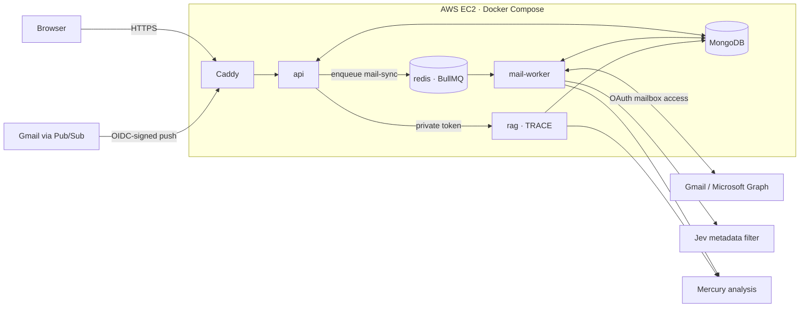
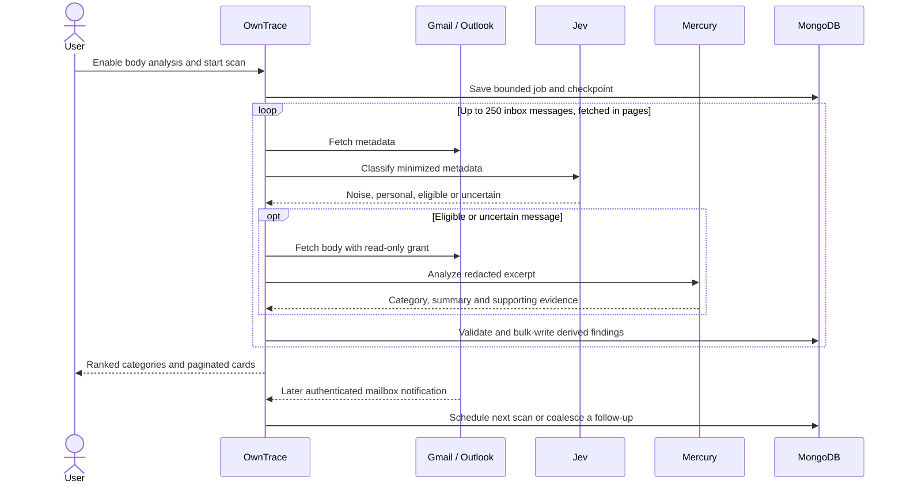
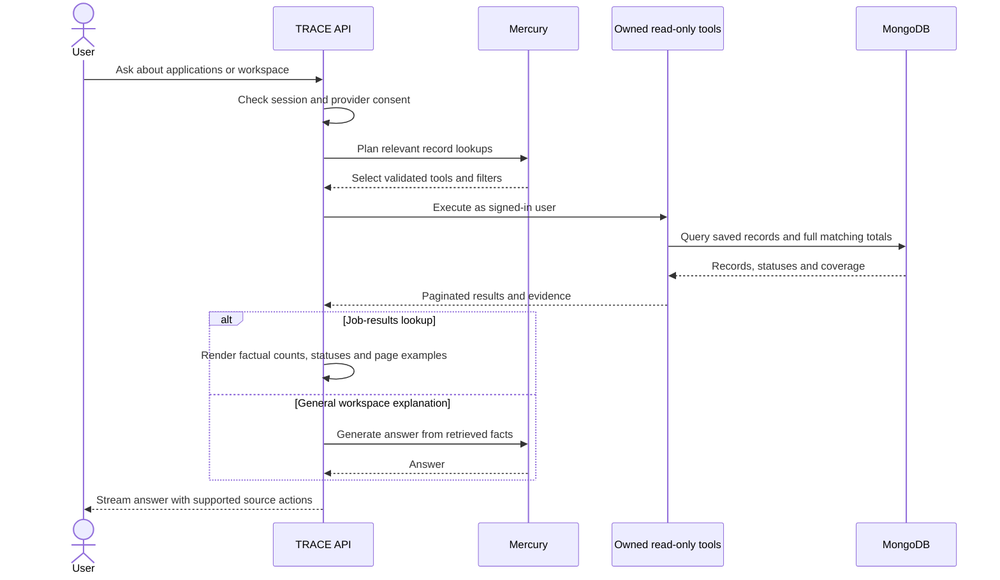

# OwnTrace

> Own your digital footprint.

OwnTrace turns email evidence into a clearer view of your accounts, subscriptions and important updates. Review the findings, inspect their evidence, and ask TRACE about your saved workspace.

**[Open OwnTrace](https://owntrace2.duckdns.org)** · [Architecture](docs/ARCHITECTURE.md) · [API reference](docs/API.md) · [Security](docs/SECURITY.md) · [Deploy](DEPLOY.md)

## Features

- **Account discovery:** Connect Gmail or Outlook through OAuth. Metadata scans identify account and subscription signals without modifying your mailbox.
- **Privacy workspace:** Dashboard, account inventory, identity graph, Privacy Inbox and security views bring related findings together. Optional XposedOrNot checks distinguish breach reports from inferred signals.
- **Top K:** A separate `/top-k` page checks up to the latest **250 inbox messages**. Jev filters obvious noise from minimized metadata; Mercury analyzes eligible redacted body excerpts. Recency, importance and required actions determine the top three categories. Marketing and suspected spam stay separate.
- **Application timelines:** Job cards show a supported company, role and dated updates when available. Application receipts, assessments, interviews and rejections remain evidence events. Job recommendations are separated from applications; search and pagination keep categories manageable. Saved results stay visible while a refresh is running.
- **TRACE assistant:** Ask about saved accounts, subscriptions, orders or job updates. Mercury selects read-only queries; concise job summaries use server-computed counts and statuses. Its built-in browser opens matching records with the same category, status, company search and page filters. Results remain live; changes require their real UI.
- **Control over access:** Metadata access and optional body analysis have separate consent. Stored OAuth tokens are encrypted. Disconnect providers or delete OwnTrace data through the supported controls.

## Architecture

OwnTrace runs as Docker Compose services on one AWS EC2 host (Ubuntu 24.04, Mumbai). One image serves three roles, set by `OWNTRACE_ROLE`:

| Service | Role | Responsibility |
| --- | --- | --- |
| `caddy` | reverse proxy | HTTPS (automatic certificates), the only service with published ports (80/443) |
| `api` | `web` | React app + Express API, auth, provider webhooks; enqueues mail syncs |
| `mail-worker` | `worker` | Mail sync, push replay, watch renewal, daily safety poll, Top K, order scans; no HTTP API |
| `rag` | TRACE service | TRACE retrieval and answers (`trace-server.js`); private, token-authenticated, no Redis or OAuth secrets |
| `redis` | queue | BullMQ `mail-sync` queue only; on an internal network reachable by api and mail-worker |
| MongoDB | data | Users, sessions, encrypted tokens, sync cursors, findings; runs on the host as `owntrace-mongo` |



**Gmail push path:** Gmail watch → Pub/Sub → `POST /api/provider-notifications/google` (OIDC verified) → one `mail-sync` job per user (deduped) → mail-worker syncs from the stored `gmailHistoryId`. MongoDB is the source of truth, so missed notifications are caught up on the next push or by the daily safety poll. If Redis is down, api falls back to queueing the sync directly in MongoDB.

Containers run read-only with all capabilities dropped and per-service AppArmor profiles. See [Deploy](DEPLOY.md), [Architecture details](docs/ARCHITECTURE.md) and [Rate limiting](docs/RATE_LIMITING.md).

### Email analysis → Top K



### TRACE assistant



## What the results mean

- **250 is an inbox window, not complete email history.** Archived, deleted or older messages can be outside the scan. A missing rejection in this window does not establish that no rejection was received.
- A company name alone does not identify an application. Supported application references and compatible role/thread evidence can link updates; ambiguous messages remain separate. Email counts, application-related groups and linked groups are different measures.
- Findings are email-derived inferences, not employer-verified application statuses or proof of active billing. Promotions can resemble job messages, and model categorization can need review.
- Some legacy job records need enrichment. Pending processing and ambiguous linkage are distinct; enrichment does not guarantee every message can be linked.
- Gmail body analysis has been exercised live. Outlook integration has automated coverage, but its body-analysis flow still needs a live mailbox test.
- Provider notifications need configured public HTTPS callbacks. They schedule bounded work; they do not mean the entire inbox is rescanned every second.

## Run locally

Requires Node.js **20.19+ on the 20.x line, or 22.12+**, npm and MongoDB.

```bash
npm install
npm run setup
# Copy server/.env.example to server/.env and configure it.
npm run dev
```

Configure `MONGO_URI` and a private `JWT_SECRET`; add OAuth client IDs, secrets, redirect URLs and `TOKEN_ENCRYPTION_KEY` for mailbox connections. Top K needs `TYPESAFE_API_KEY` and the configured Inception key/model. TRACE uses its configured conversation provider. See [the environment template](server/.env.example) for optional callbacks and execution settings. Never commit credentials, mailbox content or `.env` files.

```bash
npm run validate  # lint, client build, server syntax and tests
```

## Further optimization

Rate-limit counters are in memory, which is correct for the single api container; move them to Redis before running more than one api replica. Other next steps: profiling repeated queries, improving model batching, and a restricted MongoDB user for the rag service. The optional order write buffer (`ORDER_REDIS_URL`) remains disabled.

[Implementation details and limits](docs/ARCHITECTURE.md) · [Feature ownership](docs/OWNERSHIP.md)

Built by [Anas2694](https://github.com/Anas2694) and [RaphaelBlaster](https://github.com/RaphaelBlaster).
