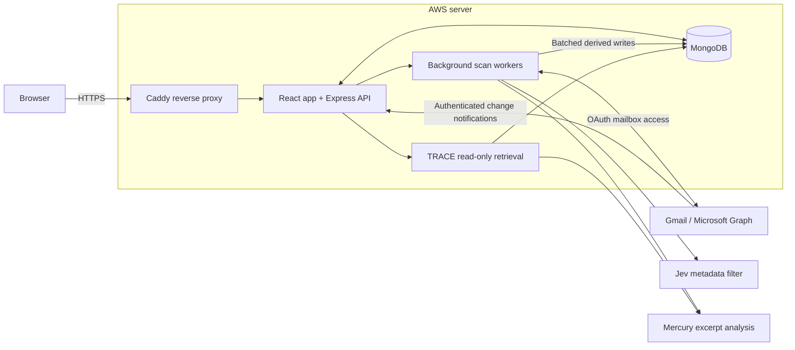
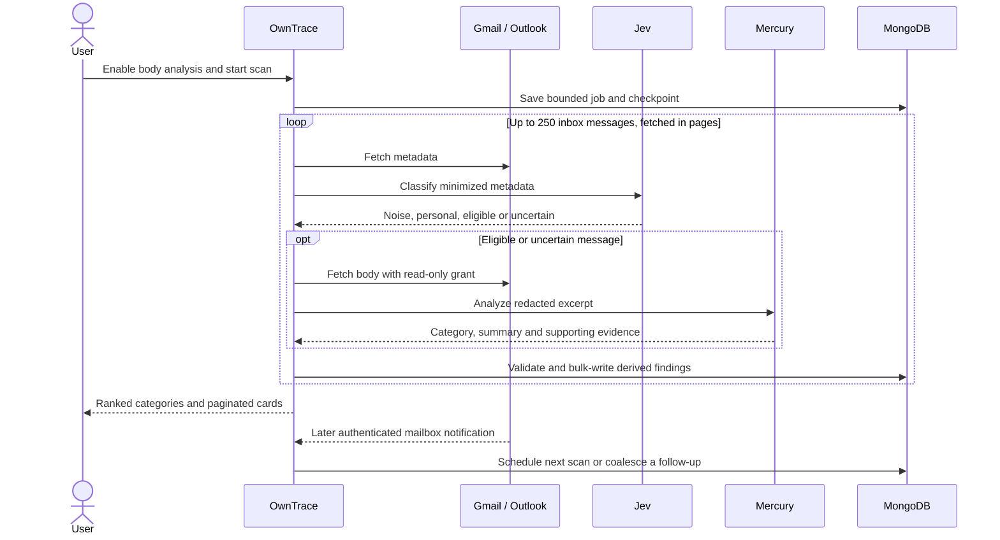
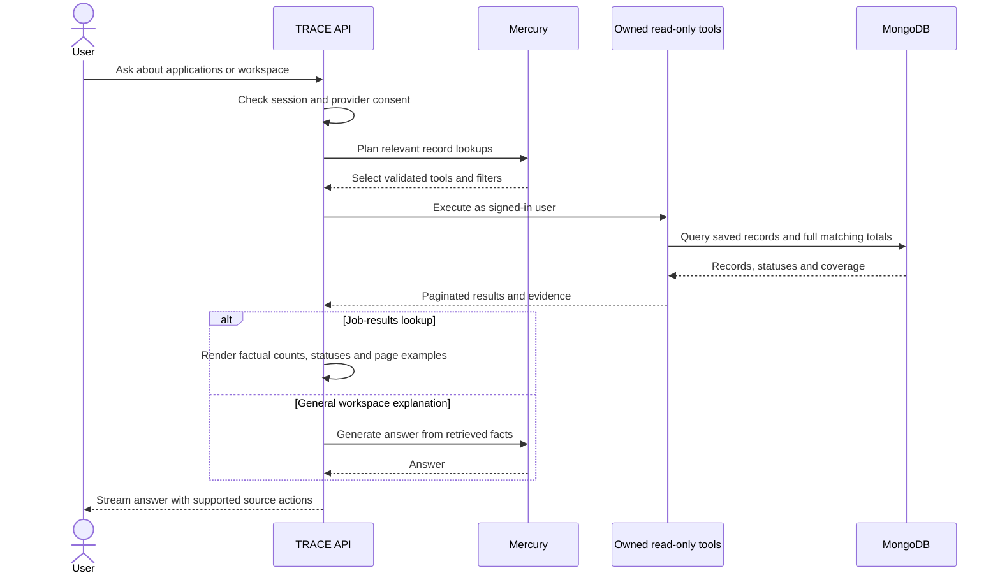

# OwnTrace

> Own your digital footprint.

OwnTrace turns email evidence into a clearer view of your accounts, subscriptions and important updates. Review the findings, inspect their evidence, and ask TRACE about your saved workspace.

**[Open OwnTrace](https://owntrace.duckdns.org)** · [Architecture](docs/ARCHITECTURE.md) · [API reference](docs/API.md) · [Security](docs/SECURITY.md)

## Features

- **Account discovery:** Connect Gmail or Outlook through OAuth. Metadata scans identify account and subscription signals without modifying your mailbox.
- **Privacy workspace:** Dashboard, account inventory, identity graph, Privacy Inbox and security views bring related findings together. Optional XposedOrNot checks distinguish breach reports from inferred signals.
- **Top K:** A separate `/top-k` page checks up to the latest **250 inbox messages**. Jev filters obvious noise from minimized metadata; Mercury analyzes eligible redacted body excerpts. Recency, importance and required actions determine the top three categories. Marketing and suspected spam stay separate.
- **Application timelines:** Job cards show a supported company, role and dated updates when available. Application receipts, assessments, interviews and rejections remain evidence events. Job recommendations are separated from applications; search and pagination keep categories manageable. Saved results stay visible while a refresh is running.
- **TRACE assistant:** Ask about saved accounts, subscriptions, orders or job updates. Mercury selects read-only queries; job-result readouts use server-computed counts and statuses. TRACE can open supported workspace pages, while changes require their real UI.
- **Control over access:** Metadata access and optional body analysis have separate consent. Stored OAuth tokens are encrypted. Disconnect providers or delete OwnTrace data through the supported controls.

## Architecture

The current deployment uses one AWS server in Mumbai. Caddy terminates HTTPS and proxies to the Node application; MongoDB stores users, connections, scan checkpoints and derived findings. Background workers run with the application. **Redis is disabled**; page batches go directly to MongoDB.



### Email analysis → Top K



### TRACE assistant



## What the results mean

- **250 is an inbox window, not complete email history.** Archived, deleted or older messages can be outside the scan. A missing rejection in this window does not establish that no rejection was received.
- A company name alone does not identify an application. Supported application references and compatible role/thread evidence can link updates; ambiguous messages remain separate. Email counts, application-related groups and linked groups are different measures.
- Findings are email-derived inferences, not employer-verified application statuses or proof of active billing. Promotions can resemble job messages, and model categorization can need review.
- Some legacy job records need enrichment. Pending processing and ambiguous linkage are distinct; enrichment does not guarantee every message can be linked.
- Gmail body analysis has been exercised live. Outlook integration has automated coverage, but its body-analysis flow still needs a live mailbox test.
- Provider notifications need configured public HTTPS callbacks. They schedule bounded work; they do not mean the entire inbox is rescanned every second.

## Run locally

Requires Node.js **20.19+ on the 20.x line, or 22.12+**, npm and MongoDB.

```bash
npm install
npm run setup
# Copy server/.env.example to server/.env and configure it.
npm run dev
```

Configure `MONGO_URI` and a private `JWT_SECRET`; add OAuth client IDs, secrets, redirect URLs and `TOKEN_ENCRYPTION_KEY` for mailbox connections. Top K needs `TYPESAFE_API_KEY` and the configured Inception key/model. TRACE uses its configured conversation provider. See [the environment template](server/.env.example) for optional callbacks and execution settings. Never commit credentials, mailbox content or `.env` files.

```bash
npm run validate  # lint, client build, server syntax and tests
```

## Further optimization

Possible next steps include profiling repeated queries, improving model batching and evaluating a shared Redis limiter when multiple application processes are needed. An optional same-host write-buffer implementation exists but is disabled in the live deployment; it is not part of the current read or write path.

[Implementation details and limits](docs/ARCHITECTURE.md) · [Feature ownership](docs/OWNERSHIP.md)

Built by [Anas2694](https://github.com/Anas2694) and [RaphaelBlaster](https://github.com/RaphaelBlaster).
